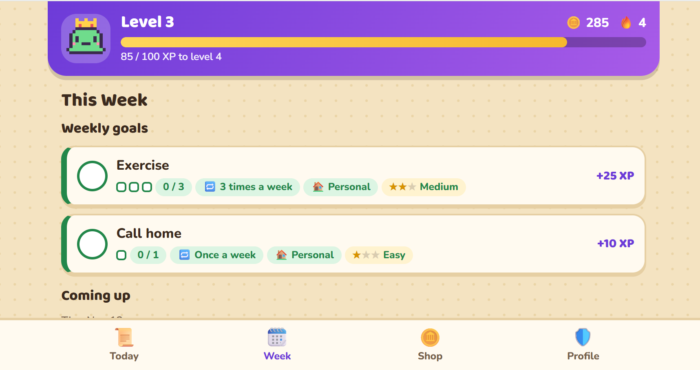

# DailyQuest

> A gamified task planner that helps busy MBA students plan their week once, then open the app each day to see exactly what to do and earn rewards for finishing it.

- **Builder:** Sabrina Tang (`@sabtyt`)
- **Pod:** 13
- **Product Page & Living PRD:** https://building-with-ai-f26.github.io/tyt223-dailytask/
- **Try it:** https://building-with-ai-f26.github.io/tyt223-dailytask/app/
- **Course:** Building with AI, NYU Stern, Fall 2026



## Why it exists

People juggling busy lives end up managing them across too many apps. MBA students track classes in Brightspace, recruiting in email and LinkedIn, events in Slack, and everything else in their notes, then piece it all together again every day. DailyQuest puts it in one place and makes staying on top of it feel like progress instead of pressure.

## What it does

- **Type to add:** open the page and start typing. DailyQuest works out the date, time, category, difficulty, and repeats.
- **Quick templates:** tap a chip like "Send thank-you note to ___", fill in the blank, and press Enter. You can save your own.
- **Today's Quests:** only what's due today, with overdue quests on top in red. Tap a circle to finish one.
- **Rewards:** earn XP, levels, badges, and streaks, then spend coins on real-life rewards you choose.
- **Week view:** weekly goals, repeating quests, what's coming up, and a summary of the week.
- **Schedule view:** a timeline of today's timed quests and calendar events, with untimed quests below.
- **Calendar import:** load a `.ics` file exported from Google Calendar. Events show as read-only and earn no XP.

### Things you can type

| You type | What happens |
| --- | --- |
| `exercise 3 times a week` | Adds a weekly goal with a 0/3 tracker on the Week tab |
| `meditate every day` | Repeats on Today every day |
| `yoga every mon and wed at 7am` | Repeats on those days at that time |
| `thank-you note by friday` | Sets a due date and files it under Recruiting |
| `coffee chat at 3pm` | Adds a start time and places it on the Schedule |
| `pset tomorrow hard` | Schedules it for tomorrow as a Hard quest |

## Try it

The easiest way is the [live app](https://building-with-ai-f26.github.io/tyt223-dailytask/app/), which works on a phone or laptop with no sign-up.

To run it on your own computer, no install, server, or API keys are needed.

```bash
git clone https://github.com/building-with-ai-f26/tyt223-dailytask.git
cd tyt223-dailytask
```

Double-click [`docs/app/index.html`](./docs/app/index.html) to open it in your browser, or run `start docs/app/index.html` (Windows) or `open docs/app/index.html` (Mac) from the repo folder.

The app opens with sample quests, rewards, and calendar events. On the **Profile** tab, **Simulate next day** demos rollover and streaks, **Reload sample data** resets the demo, and **Start empty** clears everything so you can use it for real.

## How it's built

One HTML file with plain CSS and JavaScript and no packages. Your data stays in your browser's local storage, and `.ics` files are read in the browser without being uploaded. The only network request is for Google Fonts, and the app uses system fonts if those can't load. Typed quests are understood by fixed rules, not AI.

## Current limits

- Data stays in one browser on one computer.
- Unusual phrasing becomes a plain task for today.
- No live Google Calendar sync yet; that's planned for a later build.
- `.ics` repeats like "2nd Tuesday of the month" only show their first date.

## Repository map

| File / folder | Purpose |
| --- | --- |
| [`docs/app/index.html`](./docs/app/index.html) | The DailyQuest prototype, published by GitHub Pages |
| [`docs/index.html`](./docs/index.html) | Public product page, living PRD, and weekly build log |
| [`AGENTS.md`](./AGENTS.md) | Run commands, project context, and rules for coding agents |
| [`Intent.md`](./Intent.md), [`Plan.md`](./Plan.md), [`journal/`](./journal/) | Optional drafting notes |
| [`tests/`](./tests/) | Verification guidance for Build 4 |
| [`SPONSOR_MEMO.md`](./SPONSOR_MEMO.md) | One-page recommendation, due December 14 |
