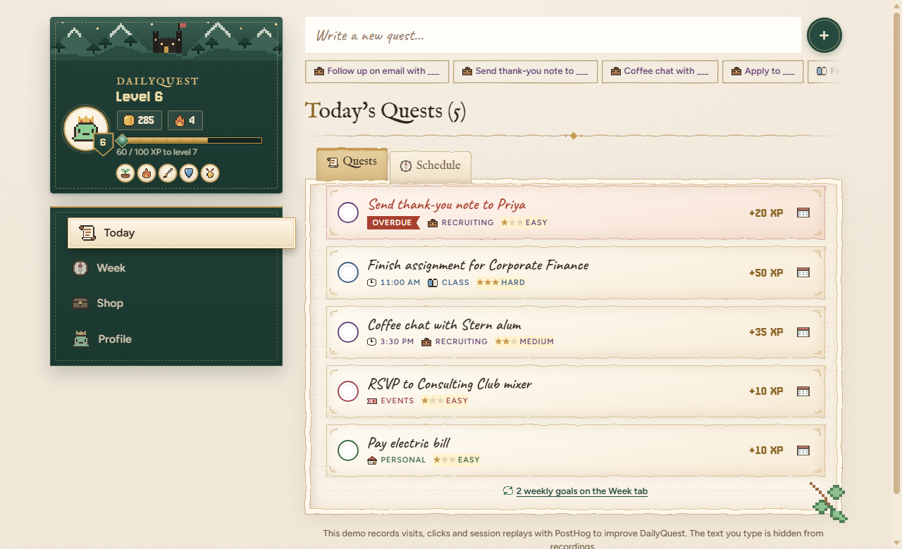

# DailyQuest

> A gamified task planner that helps busy MBA students plan their week once, then open the app each day to see exactly what to do and earn rewards for finishing it.

- **Builder:** Sabrina Tang (`@sabtyt`)
- **Pod:** 13
- **Product Page & Living PRD:** https://building-with-ai-f26.github.io/tyt223-dailytask/
- **Try it:** https://building-with-ai-f26.github.io/tyt223-dailytask/app/
- **Course:** Building with AI, NYU Stern, Fall 2026



## Why it exists

People juggling busy lives end up managing them across too many apps. MBA students track classes in Brightspace, recruiting in email and LinkedIn, events in Slack, and everything else in their notes, then piece it all together again every day. DailyQuest puts it in one place and makes staying on top of it feel like progress instead of pressure.

## What it does

- **Type to add:** open the page and start typing. DailyQuest works out the date, time, category, difficulty, and repeats.
- **Quick templates:** tap a chip like "Send thank-you note to ___", fill in the blank, and press Enter. You can save your own.
- **Today's Quests:** only what's due today, with overdue quests on top in red. Tap a circle to finish one, and tap **Undo** in the message if you didn't mean to (XP and rewards are taken back).
- **Edit and reschedule:** tap a quest to edit its title, dates, time, category, difficulty or repeat. The calendar button moves it to Today, Tomorrow, Next week or any date.
- **Smart compose:** like Gmail, a faint ending appears as you type, taken from your own past quests and templates. Press **Tab** or **→** to accept it (on a phone, tap the suggestion). With the optional AI helper running, it suggests endings for new tasks too.
- **Smart preview:** while you type, the fields DailyQuest understood appear below the box so you can fix them; Enter saves right away.
- **Rewards:** earn XP, levels, badges, and streaks, then spend coins on real-life rewards you choose.
- **Week view:** weekly goals, repeating quests, what's coming up, and a summary of the week.
- **Schedule view:** a timeline of today's timed quests and calendar events, with untimed quests below.
- **Calendar import:** load a `.ics` file exported from Google Calendar. Events show as read-only and earn no XP.
- **Public holidays:** one tap adds upcoming US (and New York) holidays to your schedule and week.
- **Game extras:** a daily loot chest of bonus coins, a streak shield you can buy to protect one missed day, hero stats that grow with each category, achievements that pay coins, and pixel avatars unlocked by level badges. Tap any badge or achievement to see what it means.
- **Optional account:** log in with email and password to save your quests to your account and use them on your phone and laptop. Without an account, everything stays in your browser.
- **Start fresh:** first-time visitors choose between sample quests and an empty board; Profile → **Start fresh** clears everything later.

### Things you can type

| You type | What happens |
| --- | --- |
| `exercise 3 times a week` | Adds a weekly goal with a 0/3 tracker on the Week tab |
| `meditate every day` | Repeats on Today every day |
| `yoga every mon and wed at 7am` | Repeats on those days at that time |
| `thank-you note by friday` | Sets a due date and files it under Recruiting |
| `coffee chat at 3pm` | Adds a start time and places it on the Schedule |
| `pset tomorrow hard` | Schedules it for tomorrow as a Hard quest |

## Try it

The easiest way is the [live app](https://building-with-ai-f26.github.io/tyt223-dailytask/app/), which works on a phone or laptop with no sign-up.

To run it on your own computer, no install, server, or API keys are needed.

```bash
git clone https://github.com/building-with-ai-f26/tyt223-dailytask.git
cd tyt223-dailytask
```

Double-click [`docs/app/index.html`](./docs/app/index.html) to open it in your browser, or run `start docs/app/index.html` (Windows) or `open docs/app/index.html` (Mac) from the repo folder.

### Optional: AI suggestions (on your own computer)

The public app never calls AI. To try AI typing suggestions locally with your own OpenAI key:

1. Copy `.env.example` to `.env` (`copy .env.example .env` on Windows) and put your key after `OPENAI_API_KEY=`. `.env` is git-ignored, so the key is never committed.
2. Run `node server.js --models` and copy a fast, low-cost model name (often "mini" or "nano") into `OPENAI_MODEL=`.
3. Run `node server.js` and open http://localhost:8787/app/. The server keeps your key, forwards suggestion requests to OpenAI, stops at `AI_DAILY_LIMIT` requests a day, and never logs what you type.

The app opens with sample quests, rewards, and calendar events. On the **Profile** tab, **Simulate next day** demos rollover and streaks, **Reload sample data** resets the demo, and **Start empty** clears everything so you can use it for real.

## How it's built

One HTML file with plain CSS and JavaScript and no packages. Your data stays in your browser's local storage unless you log in, in which case it's also saved to your own row in [Supabase](https://supabase.com) (free plan), protected so only you can read it (setup: [`supabase/README.md`](./supabase/README.md)), and `.ics` files are read in the browser without being uploaded. The app calls the free [Nager.Date](https://date.nager.at) public holidays API (no key) when you tap **Add US holidays**, loads Google Fonts (falling back to system fonts), and sends anonymous usage events and session replays to PostHog with all typed text hidden. Typed quests are understood by fixed rules, not AI. The optional [`server.js`](./server.js) (Node built-ins only, no packages) serves the app locally and adds AI typing suggestions from OpenAI; while it runs, the text you are typing and your recent quest names are sent to OpenAI.

## Current limits

- Without an account, data stays in one browser. With one, the last device to save wins if two are edited at the same moment.
- Unusual phrasing becomes a plain task for today.
- No live Google Calendar sync yet; that's planned for a later build.
- `.ics` repeats like "2nd Tuesday of the month" only show their first date.

## Repository map

| File / folder | Purpose |
| --- | --- |
| [`docs/app/index.html`](./docs/app/index.html) | The DailyQuest prototype, published by GitHub Pages |
| [`docs/index.html`](./docs/index.html) | Public product page, living PRD, and weekly build log |
| [`supabase/`](./supabase/) | Database table with privacy rules, and the account setup guide |
| [`server.js`](./server.js) | Optional local server: serves the app and adds AI typing suggestions with your key from `.env` |
| [`AGENTS.md`](./AGENTS.md) | Run commands, project context, and rules for coding agents |
| [`Intent.md`](./Intent.md), [`Plan.md`](./Plan.md), [`journal/`](./journal/) | Optional drafting notes |
| [`tests/`](./tests/) | Verification guidance for Build 4 |
| [`SPONSOR_MEMO.md`](./SPONSOR_MEMO.md) | One-page recommendation, due December 14 |
